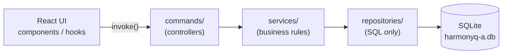

# Architecture

Structure and rules of HarmonyQ'a. It points at files rather than restating code; when the two disagree, the code wins and this file needs fixing.

## Layers (Rust, `src-tauri/src/`)

| Folder | Role | Must not |
|---|---|---|
| `commands/` | Tauri commands: take DTOs, call one service method, return the result | contain rules or SQL |
| `services/` | Validation and business rules, orchestrate repositories | know about Tauri or SQL strings |
| `repositories/` | SQL and row mapping; take `&Connection` | contain business rules |
| `db/` | Connection handle (`Db`), migration runner, `migrations/*.sql` | |
| `models/` | Domain types (`Item`, `ItemStatus`), also serialised to the UI | |
| `dto/` | Input types for the IPC boundary | |
| `error.rs` | `AppError`; serialised to the UI as a message string | |
| `state.rs` | `AppState` holding the services, managed by Tauri | |
| `utils/` | Small helpers (ids, time) | |

Dependencies point one way: commands -> services -> repositories -> db. `lib.rs` wires everything up and registers commands.

## Data

- One SQLite file in the app data dir (`%APPDATA%\harmonyq-a\harmonyq-a.db` on Windows).
- **Migrations are append-only.** Add a new `NNNN_name.sql` and list it in `db/migrations.rs`; never edit a released one. Applied count is stored in `PRAGMA user_version`.
- Timestamps are Unix milliseconds in UTC (`i64`).
- Ids are UUID v4 strings.

## Rust <-> TypeScript contract

Types are defined twice: Rust structs (`models/`, `dto/`) and TS types (`src/types/`). They match by hand for now (generated types are a planned step).

- camelCase on the wire: `#[serde(rename_all = "camelCase")]`.
- A mismatch does not error; a field silently comes through `undefined`.
- Every field added to a serialised struct that is read back from stored data needs a migration default.

## Frontend (`src/`)

- `components/`: UI only. `components/shell/` is the app frame (sidebar, list of views). `components/ui/` holds shadcn/ui primitives generated by `npx shadcn@latest add <name>`; compose them instead of hand-rolling CSS.
- `hooks/`: state per domain (`useItems`); call the API, hold React state.
- `lib/api/`: one typed `invoke` wrapper per command; no logic.
- `lib/utils.ts`: `cn()` for merging class names.
- `types/`: TS mirror of the Rust types.
- Imports use the `@/` alias for `src/`.
- Styling: Tailwind v4 + theme tokens in `src/index.css` (`:root` light, `.dark` dark). Components use tokens (`bg-card`, `text-muted-foreground`), never raw colors.

## Where to make a change

| Change | Start in |
|---|---|
| New field on an item | new migration, `models/item.rs`, `repositories/item_repo.rs`, `src/types/item.ts` |
| New business rule | `services/` (+ a unit test next to it) |
| New command | `commands/`, register in `lib.rs`, add wrapper in `src/lib/api/` |
| New table | new migration, new model, repo, service, commands |

## Checks

`cargo test` (service tests use an in-memory database), `cargo clippy -- -D warnings`, `cargo fmt --check`, `npm run build` (includes `tsc`).
